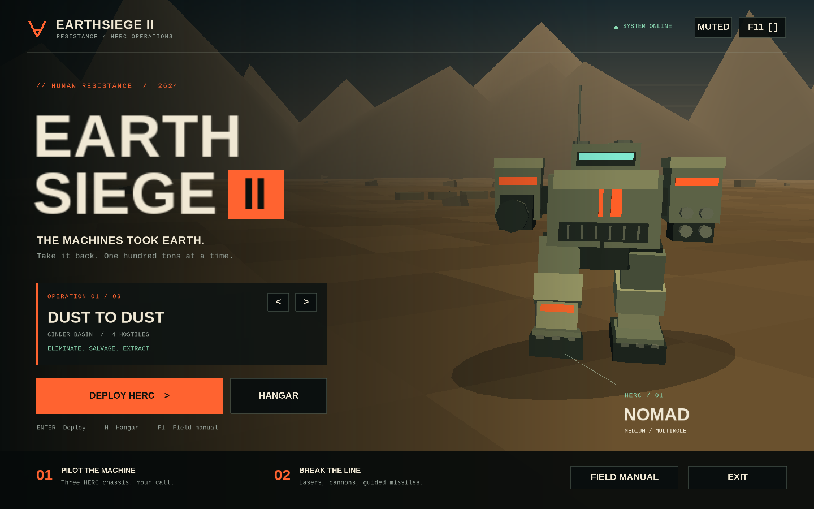
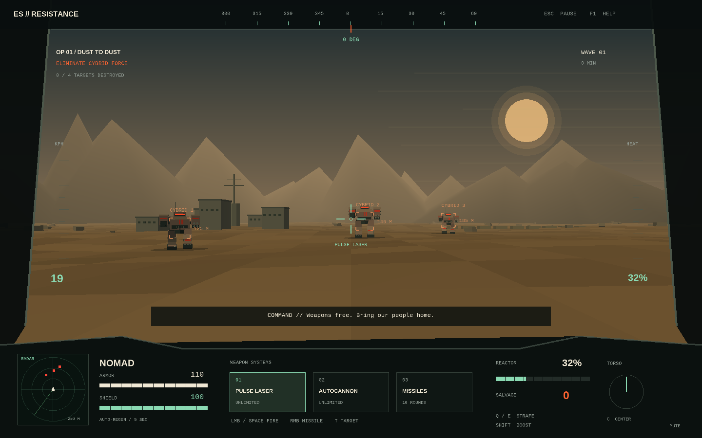

# Earthsiege II: Resistance

A **native Linux mech-combat game** written in C++17 with SDL2 and OpenGL. This is a playable, independently implemented recreation of the Earthsiege-style combat loop, with original procedural models, terrain, interface, and sound. It is a small game, not a port of the complete commercial campaign.

## Run

If using the packaged archive, extract it and run `./earthsiege` from the extracted folder. Keep the `assets` directory beside the executable.

From this source directory:

```sh
./run.sh
```

The launcher builds the game and opens a native desktop window. To run the already compiled executable directly:

```sh
./build/earthsiege
```

No browser, web server, network connection, or original game files are required. Launch from a terminal in your graphical Linux desktop session. Both X11 and Wayland are supported through SDL. The window is resizable; **F11** toggles fullscreen.

Build dependencies: a C++17 compiler, CMake 3.16+, pkg-config, SDL2, SDL2_ttf, and OpenGL development libraries. These were already available on the development machine. Runtime dependencies are SDL2, SDL2_ttf, the C++ runtime, and an OpenGL 2.1-compatible graphics driver. SDL2 compatibility implementations backed by SDL3 work too.

## Play

Select an operation on the title screen, or open **Hangar** to choose a HERC. Press **Enter** or click **Deploy HERC**. See the in-game field manual with **F1**.

| Control | Action |
| --- | --- |
| W / S | Move forward / reverse |
| A / D | Turn the chassis |
| Q / E | Strafe |
| Mouse | Aim the torso independently of the legs |
| Arrow keys | Aim without a mouse |
| C | Center torso and aim |
| Shift | Boost; generates additional heat |
| Left mouse / Space | Fire selected weapon |
| Right mouse | Launch a guided missile |
| 1 / 2 / 3 | Laser / autocannon / missiles |
| T / Tab | Cycle hostile target |
| Escape | Pause and release the mouse |
| F1 | Field manual |
| M | Mute / unmute |
| F11 | Fullscreen |

Destroy all enemy waves, then walk into the green extraction beacon. The radar shows hostiles in red and salvage/extraction in green. Extraction banks your recovered salvage and a mission bonus. Defeat loses the current mission's unbanked salvage.

Shields regenerate five seconds after the last hit. Weapons shut down at maximum reactor heat until the reactor cools below 42%. Guided missiles home on a target in front of you; laser and cannon shots require aiming. Buildings block movement and fire. Disabling enemy legs preserves more salvage than destroying the torso. Walk within 19 meters of a green salvage crate to collect it and repair 12 armor.

Spend banked salvage in the hangar on shield capacitors and weapon amplifiers. Upgrades apply to all three chassis. The **Nomad** is balanced, **Bastion** trades speed for armor and firepower, and **Strider** favors mobility. Three operations increase the size and strength of the enemy force. All use the same desert battlefield, with a ruined relay station and surrounding mountains.

## Save data

Pilot data is saved atomically to `$XDG_DATA_HOME/earthsiege-resistance/pilot.sav`, or `~/.local/share/earthsiege-resistance/pilot.sav` if `XDG_DATA_HOME` is unset. Chassis choice, operation, sound setting, salvage, completed operation count, and upgrades persist. Missions restart from the beginning; there is no mid-mission save.

For a portable save location:

```sh
./build/earthsiege --save-dir ./pilot-data
```

If no audio device is available, the game continues silently. If a display is unavailable, run the offscreen tests below; interactive play requires a graphical session.

## Build and test

```sh
cmake -S . -B build -DCMAKE_BUILD_TYPE=Release
cmake --build build --parallel
ctest --test-dir build --output-on-failure
./tests/native-smoke.sh
```

Simulation tests exercise movement, armor/shields, weapon cooldowns and hits, missiles, overheating, targeting, salvage, collisions, cover, waves, victory/defeat, reset, and a simulated pilot completing all three operations with ordinary weapons and incoming enemy damage. Native smoke tests create actual SDL/OpenGL contexts, render every screen, check GL errors, and exercise menu clicks, hotkeys, upgrades, pause, restart, and persistence through SDL events.

For a native rendering screenshot without a display:

```sh
SDL_VIDEODRIVER=offscreen SDL_AUDIODRIVER=dummy \
  ./build/earthsiege --smoke-test --scene combat --frames 120 \
  --screenshot /tmp/earthsiege.ppm
```

Other scenes: `menu`, `hangar`, `pause`, `controls`, `debrief`, and `flow` (scripted UI integration test). PPM screenshots can be opened by standard image tools. `--help` lists command-line options.

Optional installation into a prefix:

```sh
cmake --install build --prefix ./build/install
./build/install/bin/earthsiege
```

To make a relocatable tar archive for a compatible Linux system:

```sh
./package.sh
```

The archive includes the executable, fonts, icon, and README. System libraries are dynamically linked; rebuild from source on Linux distributions with older/incompatible runtime libraries.

## Source layout

- `src/simulation.*`: graphics-independent combat, movement, collision, AI, and mission rules.
- `src/renderer.*`: procedural 3D models, terrain, cockpit HUD, menus, and font atlas.
- `src/audio.*`: procedural audio mixed through SDL.
- `src/main.cpp`: native window, input, fixed-step simulation, menu actions, and pilot saves.
- `tests/`: simulation and native rendering/input integration tests.

The simulation runs at 120 Hz independently of rendering. The renderer uses the OpenGL compatibility pipeline for broad support and a deliberately low-poly appearance. Audio uses no recordings or external assets.

## Screenshots





## Credits

Inspired by [Earthsiege 2 by Dynamix/Sierra](https://www.sierragamers.com/earthsiege-2/). This project is an unofficial fan recreation; it includes no original game code, models, textures, music, or campaign data. Earthsiege names belong to their respective owners.

Bundled Liberation Sans and Liberation Mono fonts are licensed under the SIL Open Font License. See `assets/fonts/LICENSE`.
